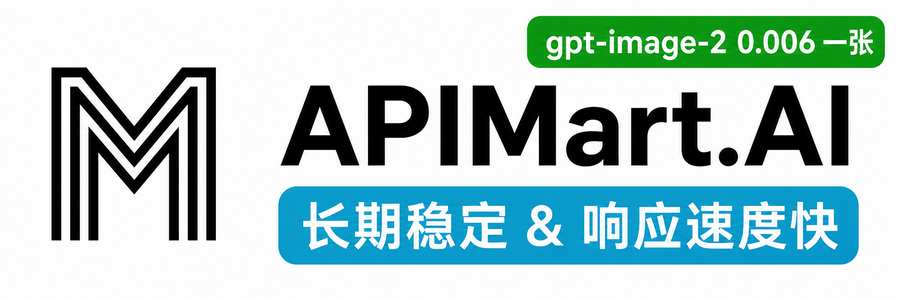

# AI Provider Scheduling

[English](README.md) | 中文 | [日本語](README_JA.md)

AIProviderScheduling 是一个为 CLI 提供 OpenAI/Gemini/Claude/Codex/Grok 兼容 API 接口的代理服务器。

您可以通过任何与 OpenAI（包括 Responses）、Gemini（包括 Interactions）或 Claude 兼容的客户端或 SDK，使用提供商 API Key 在本地访问以下提供商。

<table>
<tbody>
    <tr>
        <th align="center" width="100">提供商</th>
        <th align="center">说明</th>
    </tr>
    <tr>
        <td align="center"></td>
        <td>Kimi 系列模型（Kimi K3、K2.7 Code 等）。<a href="https://platform.kimi.com/docs/guide/kimi-k3-quickstart">Kimi K3</a> 是 Moonshot AI 迄今能力最强的模型，也是全球首个开源 3T 级模型。K3 拥有 2.8T 参数、原生视觉能力与 100 万 Token 上下文，面向长周期编码、知识工作与推理任务。AIProviderScheduling 支持通过兼容 API Key 接入 Kimi。立即体验 <a href="https://www.kimi.com/code/">Kimi Code 订阅</a>，或前往 <a href="https://platform.kimi.com?track_id=track-f15622e7182046baa22ca35e006e13a7">Kimi 开放平台</a> 获取 API Key。感谢 Kimi 对 AIProviderScheduling 及开源社区的支持！</td>
    </tr>
    <tr>
        <td align="center"></td>
        <td>OpenAI GPT 系列模型（GPT 5.6、GPT 5.5 等）。GPT-5.6 为复杂生产工作流树立了新的质量与效率基线。GPT-5.6 尤其节省 token，并提升了前端审美表现，包括布局、视觉层级与设计判断力。</td>
    </tr>
    <tr>
        <td align="center"></td>
        <td>Anthropic Claude 系列模型（Claude Fable、Claude Opus、Claude Sonnet 等）。Claude Fable 5 是 Anthropic 公开发布中能力最强的模型，专为最严苛的推理与长周期智能体任务打造。</td>
    </tr>
    <tr>
        <td align="center"></td>
        <td>Google Gemini 系列模型（Gemini 3.5 Flash、Gemini 3.1 Pro 等）。Gemini 3.5 Flash 提供面向真实世界任务优化的持续前沿级智能，速度更快、成本更低。面向智能体时代设计，擅长子智能体部署、多步骤工作流以及大规模长周期任务。该模型尤其适合包含复杂编码循环与迭代的快速智能体回路。</td>
    </tr>
    <tr>
        <td align="center"></td>
        <td>xAI Grok 系列模型（Grok 4.5、Grok Composer 2.5 Fast 等）。Grok 4.5 是 SpaceXAI 面向编程、智能体任务与知识工作打造的前沿模型。它在 SpaceXAI 位于孟菲斯的数据中心训练，并使用了覆盖科学、工程与数学的新数据集。</td>
    </tr>
</tbody>
</table>

## 赞助商

感谢 PackyCode 对本项目的赞助！

PackyCode 是一家可靠高效的 API 中转服务商，提供 Claude Code、Codex、Gemini 等多种服务的中转。

---

<table>
<tbody>
<tr>
<td width="180"></td>
<td>感谢 AICodeMirror 赞助了本项目！AICodeMirror 提供 Claude Code / Codex / Gemini 官方高稳定中转服务，支持企业级高并发、极速开票、7×24 专属技术支持。 Claude Code / Codex / Gemini 官方渠道低至 3.8 / 0.2 / 0.9 折，充值更有折上折！AICodeMirror 为 AIProviderScheduling 的用户提供了特别福利，通过<a href="https://www.aicodemirror.ai/register?invitecode=TJNAIF" target="_blank">此链接</a>注册的用户，可享受首充8折，企业客户最高可享 7.5 折！</td>
</tr>
<tr>
<td width="180"></td>
<td>RunAPI 是高效稳定的API OpenRouter平替平台，一个 API Key 即可访问 OpenAI、Claude、Gemini、DeepSeek、Grok 等 150+ 主流模型，低至 1 折，极其稳定，可以无缝兼容 Claude Code、OpenClaw 等工具。RunAPI 为 AIProviderScheduling 的用户提供专属福利：<a href="https://runapi.host/register?aff=FivD">注册</a>联系管理员即可领取￥7的免费额度</td>
</tr>
<tr>
<td width="180"></td>
<td>赛博支付（CyberPay）成立于2021年。我们致力于为AI从业者商家提供稳定、高效、安全的支付结算解决方案。与我们合作即可使您的网站平台解决用户支付宝/微信收款问题。承接售卖GPT 、Gemini、Claude、Codex账号与中转站等各类业务合作，解决各位商家收款困难痛点。<a href="https://t.me/CyberWlD/218">联系我们</a>开启您的致富通道。</td>
</tr>
<tr>
<td width="180"></td>
<td>感谢 <a href="ugrhpghttps://console.apito.ai/agent/register/pJq9T52Fpugrhpgo">Claude API</a> 赞助本项目！Claude API 是专注 Claude 模型的官方渠道 API 服务商，基于 Anthropic 官方 Key 与 AWS Bedrock 官方渠道，提供稳定的 Claude Code 与 Agent 应用接入体验，支持 Claude 全系列模型，保留 Tool Use、长上下文等官方能力。服务非逆向、非降智，适合 Claude Code 深度用户、Agent 工程师与企业技术团队使用。通过<a href="https://console.apito.ai/agent/register/pJq9T52Fpugrhpgo">专属链接</a>注册后联系客服，可领取免费测试额度，并支持开票和团队对接。</td>
</tr>
<tr>
<td width="180"></td>
<td>感谢 <a href="https://code0.ai/agent/register/slxVMR3uVBoRgNBf">Code0</a> 赞助本项目！code0.ai 是面向开发者与技术团队的 AI 编程工作台，聚合 Claude Code、Codex 等主流 Agent 编程能力，支持代码生成、项目理解、调试修复、代码审查与文档生成等常见研发场景。适合独立开发者、Agent 工程师、开源项目维护者和企业研发团队使用，支持开票和团队对接。通过<a href="https://code0.ai/agent/register/slxVMR3uVBoRgNBf">专属链接</a>注册后联系客服，可领取免费测试额度，体验更高效的 AI 编程工作流。</td>
</tr>
<tr>
<td width="180"></td>
<td>FennoAI 是一家稳定、高效的API 中转服务商，目前主要提供 Codex 中转服务，兼容OpenAI 及 Anthropic 协议，可灵活接入 Codex、Claude Code、OpenCode等主流编程工具，可稳定支撑千亿Token/日的企业级调用需求，支持国内及海外主体公对公结算、开票。FennoAI 为 AIProviderScheduling 的用户提供了专属福利：通过<a href="https://api.fenno.ai/s/Cvf0">专属链接</a>购买订阅，仅需 1.99 美元即可获得价值 50 美元的 Coding Plan 额度。同时支持邀请奖励，邀请好友购买最高可获得 20% 返佣，邀请越多，奖励越高。</td>
</tr>
<tr>
<td width="180"></td>
<td>感谢 <a href="https://s.qiniu.com/7zUJri">七牛云AI</a> 赞助本项目！七牛云AI 是七牛云(02567.HK)旗下企业级大模型MaaS平台，一站式调用全球 150+ 主流模型，兼容全球主流模型厂商协议，覆盖文本、图像、音频、视频、文件处理等全模态处理能力，服务超过 169 万企业及开发者用户。专属福利：企业用户免费领 <b>1200万 Token</b>，邀请好友最高得百亿 Token。</td>
</tr>
<tr>
<td width="180"></td>
<td>感谢 Cubence 对本项目的赞助！Cubence 是一家可靠高效的 API 中转服务商，提供 Claude Code、Codex、Gemini 等多种服务的中转。</td>
</tr>
<tr>
<td width="180"></td>
<td>感谢 <a href="https://www.fastaitoken.com/">FastAIToken</a> 对本项目的赞助！ FastAIToken 是面向开发者的 AI API 聚合平台，追求极速、稳定。支持 OpenAI、Claude、Gemini 等主流大模型，充值 1:1，1 元 = 1 美元 API 额度，让开发者以更低成本、更便捷地使用全球领先的大模型服务，QQ服务群1054566214。 平台提供多种渠道自由选择：超级低价的0.02x OpenAI 福利分组（限时）、低至 0.25x OpenAI 分组、0.7x Claude 95%固定缓存、1.2x Claude Max 渠道；同时提供公开状态页，实时展示各分组的可用率、延迟及运行状态，服务透明可靠，并提供 7×24 小时真人技术支持（非机器人），快速响应开发者需求。针对企业用户可以构建SLA专线号池，包稳定，可签合同开票专人维护。</td>
</tr>
<tr>
<td width="180"></td>
<td>担心模型掺水、降智或价格不透明？全球领先模型聚合服务Infistar.ai，在售模型均经过真实调用验真，供给来自官方 API 与官方号池，超10000条供应链路进行负载均衡，保证时延和峰时稳定性。覆盖 ChatGPT、Claude、Gemini、Grok、GLM、DeepSeek、Kimi、Qwen、MiniMax等国内外主流模型，覆盖文本，视频，图片，嵌入，重排等全模态能力，价格与用量透明清晰可查，模型低至官方价的 10%。AIProviderScheduling 用户可通过专属入口注册体验 邀请链接：<a href="https://www.infistar.cc/register?aff=FQKC6J6R&ref_source=link">https://www.infistar.cc/register?aff=FQKC6J6R&ref_source=link</a></td>
</tr>
<tr>
<td width="180"></td>
<td>感谢 APIMart 赞助了本项目！APIMart 是专注 AI 图片/视频生成的低价 API 平台，GPT-Image-2 低至 &#36;0.006/张，1 美元可出图 160+ 张。图片、视频一套异步 API 通吃，提交任务拿 ID、回调取结果，跑批万张不超时、换模型不改代码。按量付费、无月费，通过<a href="https://go.apimart.ai/">此注册链接</a>注册即可开用。</td>
</tr>
</tbody>
</table>

## 功能特性

- 为 CLI 模型提供 OpenAI/Gemini/Claude/Codex/Grok 兼容的 API 端点
- 新增 OpenAI Codex（GPT 系列）支持（提供商 API Key）
- 新增 Claude Code 支持（提供商 API Key）
- 新增 Grok Build 支持（提供商 API Key）
- 支持流式、非流式响应，以及受支持场景下的 WebSocket 响应
- 函数调用/工具支持
- 多模态输入（文本、图片）
- 多条提供商 API Key 的权重 / 优先级调度（Gemini、OpenAI、Claude、Grok）
- 支持 Gemini AIStudio API 密钥
- 支持 AI Studio Build 提供商 Key 调度
- 支持 Claude Code 提供商 Key 调度
- 支持 OpenAI Codex 提供商 Key 调度
- 支持 Grok Build 提供商 Key 调度
- 通过配置接入上游 OpenAI 兼容提供商（例如 OpenRouter）
- 可复用的 Go SDK（见 `docs/sdk-usage_CN.md`）

## 新手入门

AI Provider Scheduling 用户手册： [https://help.router-for.me/](https://help.router-for.me/cn/)

## 管理 API 文档

请参见 [MANAGEMENT_API_CN.md](https://help.router-for.me/cn/management/api)

## 集群

多节点 master/slave 配置同步：[docs/cluster_CN.md](docs/cluster_CN.md)

## 使用量统计

自 v6.10.0 起，AIProviderScheduling 及 [APSMC](https://github.com/icaruszezen/AI-Provider-Scheduling-Management-Center) 不再预置使用量统计。

## SDK 文档

- 使用文档：[docs/sdk-usage_CN.md](docs/sdk-usage_CN.md)
- 高级（执行器与翻译器）：[docs/sdk-advanced_CN.md](docs/sdk-advanced_CN.md)
- 认证: [docs/sdk-access_CN.md](docs/sdk-access_CN.md)
- 凭据加载/更新: [docs/sdk-watcher_CN.md](docs/sdk-watcher_CN.md)
- 自定义 Provider 示例：`examples/custom-provider`

## 贡献

欢迎贡献！请随时提交 Pull Request。

1. Fork 仓库
2. 创建您的功能分支（`git checkout -b feature/amazing-feature`）
3. 提交您的更改（`git commit -m 'Add some amazing feature'`）
4. 推送到分支（`git push origin feature/amazing-feature`）
5. 打开 Pull Request

## 许可证

此项目根据 MIT 许可证授权 - 有关详细信息，请参阅 [LICENSE](LICENSE) 文件。

## 写给所有中国网友的

QQ 群：188637136（满）、1081218164

或

